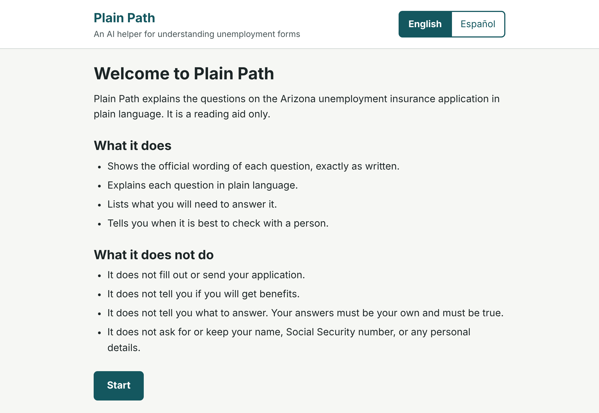
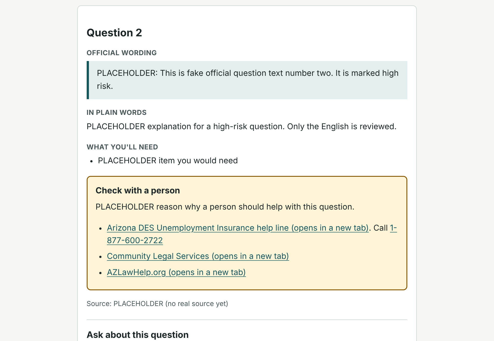
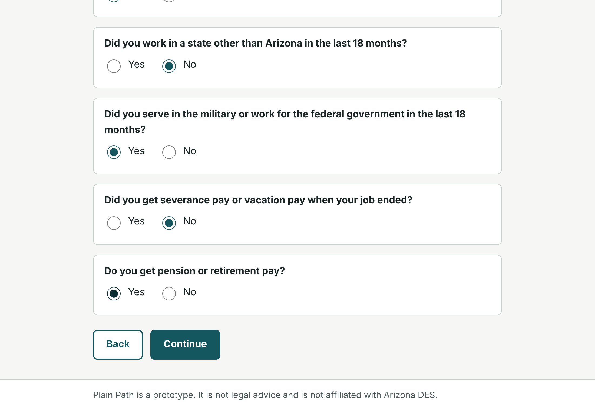
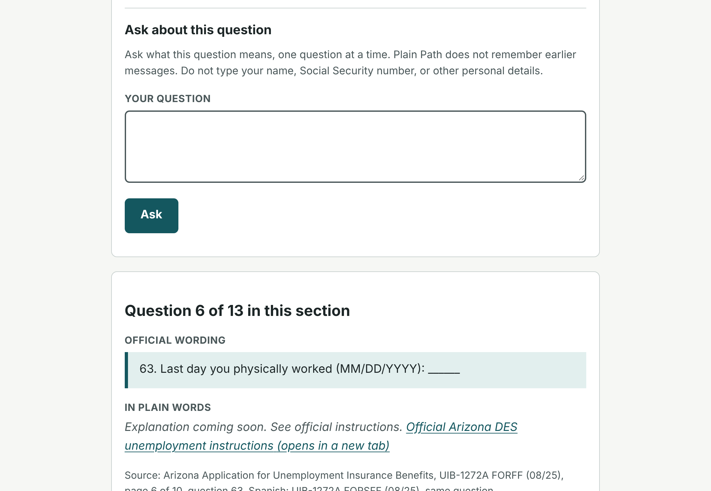
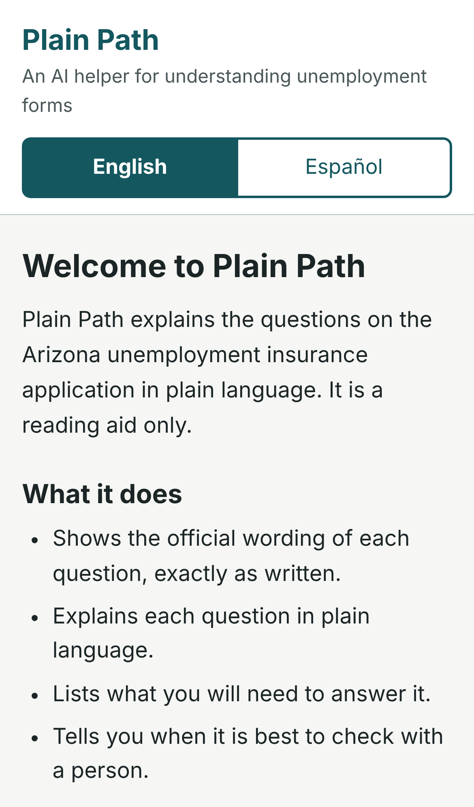
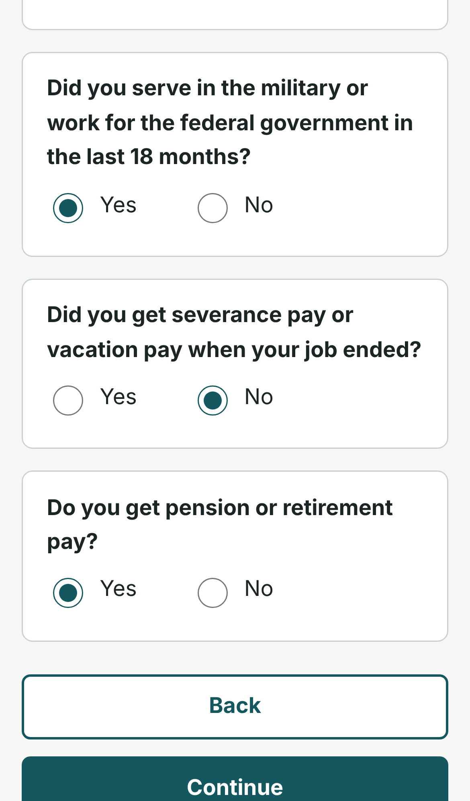
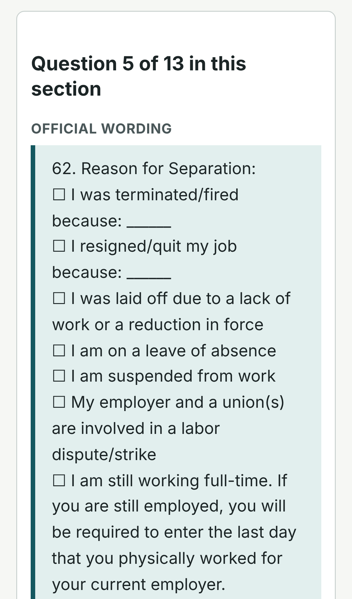
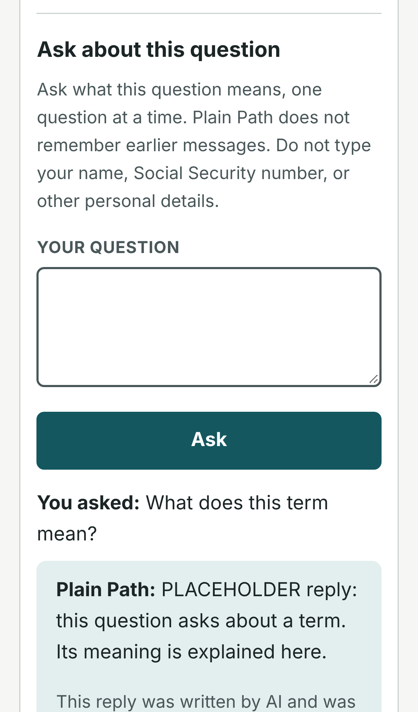

# Plain Path

[](https://github.com/1morepush/plain-language-benefits/actions/workflows/ci.yml)

**An AI helper for understanding unemployment forms.**

Applying for unemployment means answering questions written in legal language, often
right after losing a job. Plain Path explains each question on the Arizona unemployment
insurance application in plain English and Spanish, so a person understands what is being
asked before they answer.

It is a reading aid only. It never fills out the form, never says whether someone will
get benefits, and never tells anyone what to answer.

> Plain Path is a prototype. It is not legal advice and is not affiliated with Arizona DES.

## What it looks like

### On a computer

| Welcome | A question, with "Check with a person" |
|---------|------------------------------------------|
|  |  |

| Intake | Ask about this question |
|--------|-------------------------|
|  |  |

### On a phone

| Welcome | Intake | A question | Ask about it |
|---------|--------|------------|--------------|
|  |  |  |  |

*These are real screenshots of the app, showing question 62 of Arizona's application.
The plain-language explanations are still waiting for review, so the cards show
"Explanation coming soon".*

## What it does

A person walks through the application one section at a time:

1. **Intake.** Five yes/no questions, such as "Did you work in another state?" The
   answers only shape the document checklist. Nothing is sent anywhere.
2. **Pause and gather documents.** A checklist built from the intake answers.
3. **The form, section by section.** For each question it shows:
   - the **official wording**, always visible and never changed;
   - a **plain-language explanation** at about an 8th-grade reading level;
   - **what you'll need** to answer it;
   - a **"Check with a person"** box on high-risk questions, with the Arizona DES UI help
     line and two legal aid links.
4. **Optional: "Ask about this question."** A box for one short follow-up about the
   question on screen.

Everything is in English and Spanish, and the site is built for phones as well as
computers.

## Hard rules

These matter more than features. All of them are written into the system prompt
([`plain-path/prompts/system.md`](plain-path/prompts/system.md)), and most are also
enforced in code.

| Rule | How it is enforced |
|------|--------------------|
| Never fill out, submit, or connect to the real application | The app has no connection to it. |
| Never decide or predict eligibility | System prompt, plus a keyword check on every chat reply. |
| Never suggest, rank, or reword an answer | System prompt, plus the same keyword check. |
| No personal data | SSN-shaped text is blocked in the browser and again on the server, before it can reach the AI. Nothing a user types is stored. |
| Never make up form content | Official wording is copied from Arizona's own form (see below). A question that is not in the data file gets a fixed "can't help with that" reply. |
| Disclaimer on every page | It is in the page footer. |

## Where the questions come from

The official wording is copied word for word from the **Arizona Application for
Unemployment Insurance Benefits**, form UIB-1272A (revision 08/25), in English and
Spanish. Both PDFs are in [`plain-path/source_docs/`](plain-path/source_docs/), and every
question in the data file names the page and question number it came from.

Plain Path currently covers 40 items from the form: the ones that use terms a person may
need explained, such as the reason for separation, being "able" and "available" for work,
and severance or pension payments. Fields like name and address are left out.

## How the AI is used

Accuracy comes first, so the AI's work is checked before people see it.

- **Explanations are drafted ahead of time.** A script asks Claude (`claude-sonnet-5-5`)
  for one draft per question. A draft stays hidden until a person marks it as reviewed,
  separately for English and Spanish.
- **The question box is the one live part.** Its replies are labelled as written by AI
  and not reviewed, they pass through a keyword check first, and the help line and legal
  aid links are shown under every reply.
- **A test set measures how well the rules hold.** Twenty test questions, including
  seven that ask the tool what to answer, are sent to Claude. The replies are saved to a
  spreadsheet, flagged by an automatic check, and scored by hand on relevance, accuracy,
  completeness, clarity, coherence and appropriateness.

## Try it

You need Python 3.10 or newer.

```bash
cd plain-path
```

```bash
pip install -r requirements.txt
```

```bash
python app.py
```

Open <http://127.0.0.1:5000>. The walkthrough works without an API key.

To open it on a phone on the same Wi-Fi, start it this way and type the address it
prints into the phone's browser:

```bash
python app.py --phone
```

The full guide is in **[plain-path/README.md](plain-path/README.md)**: adding questions,
drafting and reviewing explanations, where the API key goes, running the tests, and what
each file does.

## Current status

The app, the explanation pipeline, the question box and the test harness are all built,
and 106 automated tests pass.

- [x] Real questions from Arizona's form, in English and Spanish.
- [x] The DES help line number, confirmed against the form.
- [ ] Draft the explanations with Claude and review them. Until then, every question
      shows "Explanation coming soon". The code that calls Claude has only been tested
      with a fake Claude so far.
- [ ] Check the transcription of the official wording against the PDFs, and decide which
      questions should carry the "Check with a person" box.
- [ ] Verify the two legal aid links in `plain-path/data/help_links.json`. They were
      written from memory.
- [ ] Have a fluent Spanish speaker read the Spanish text.

## What's in this repository

```
plain-path/            Plain Path: the app, data files, prompts, scripts, and tests
README.md              this page
NOTICE_TRANSLATOR.md   the first project here: a benefits notice translator
src/ evals/ tests/ docs/ workshop/ sample_docs/ ...
                       files that belong to the notice translator
.github/workflows/     automated tests for both, plus the Plain Path live-tests run
```

This repository started as **Plain Language**, a tool that rewrites confusing benefits
notices (letters people have already received) into plain language. Plain Path grew out
of it and reuses its safety ideas, but it is a separate app. The notice translator is
documented in **[NOTICE_TRANSLATOR.md](NOTICE_TRANSLATOR.md)**.

## AI Use

This project was built with help from Claude Code (Anthropic). Claude Code wrote the
first version of the code, tests, and documentation from a written project plan, and
each stage was reviewed by hand before moving on.

Inside the tool, plain-language explanations are drafted by the Claude API
(`claude-sonnet-5-5`) using the system prompt in `plain-path/prompts/system.md`, and are
shown only after a person has reviewed them. Replies in the "Ask about this question" box
are also written by the Claude API, live, and are labelled as not reviewed.

## License

Released under the [MIT License](LICENSE).
