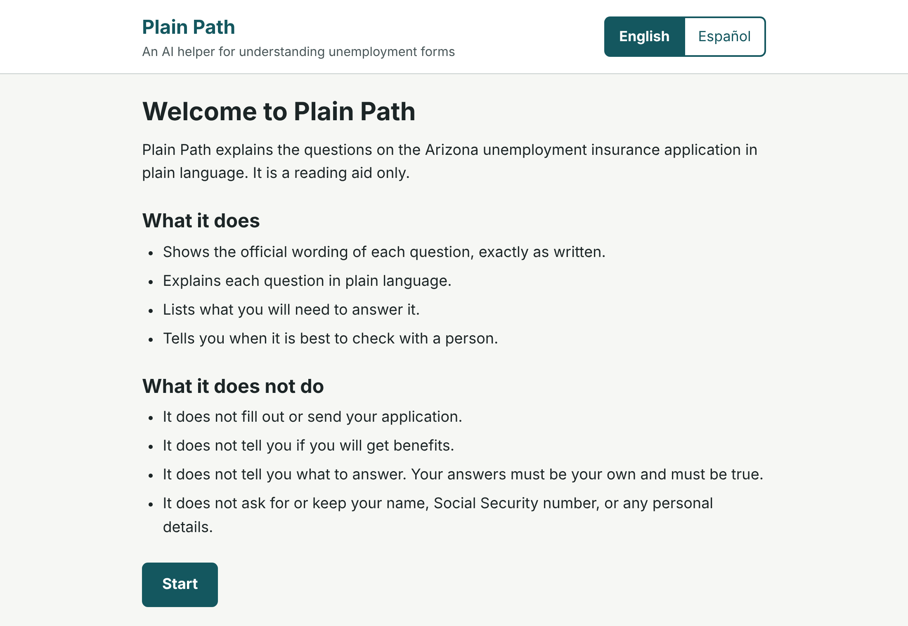
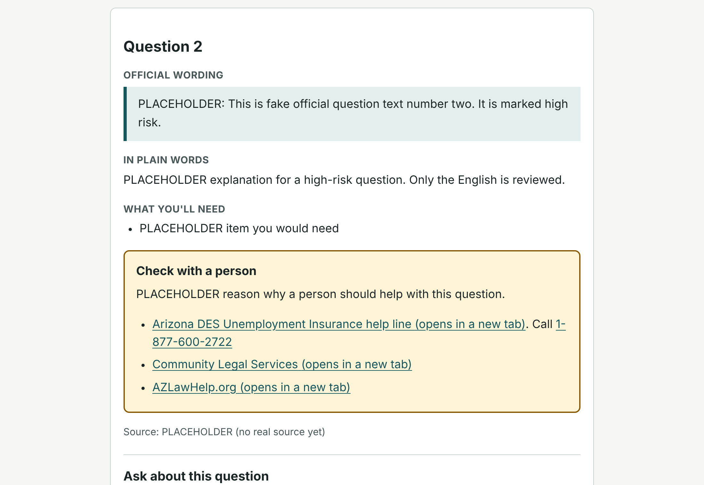
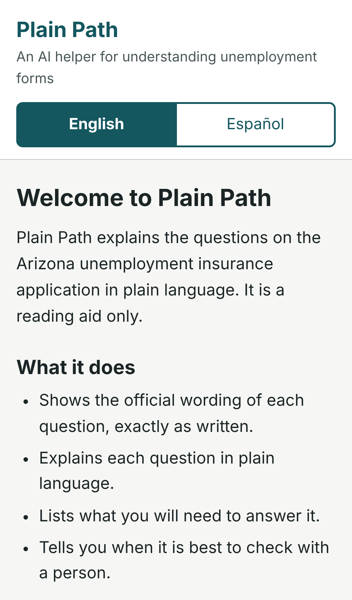
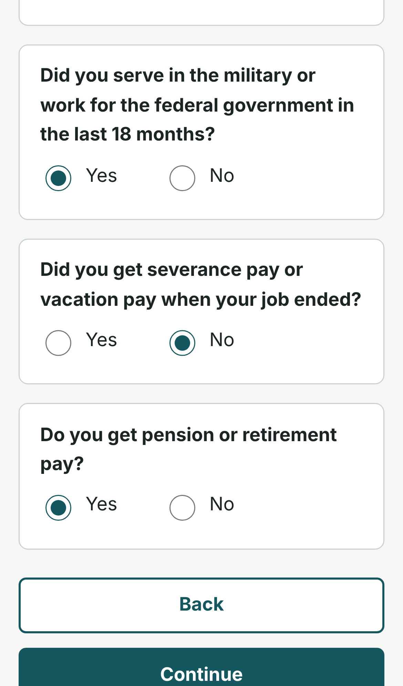
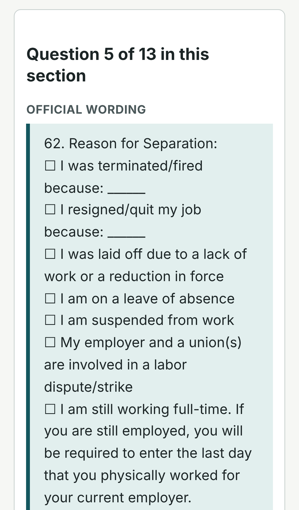
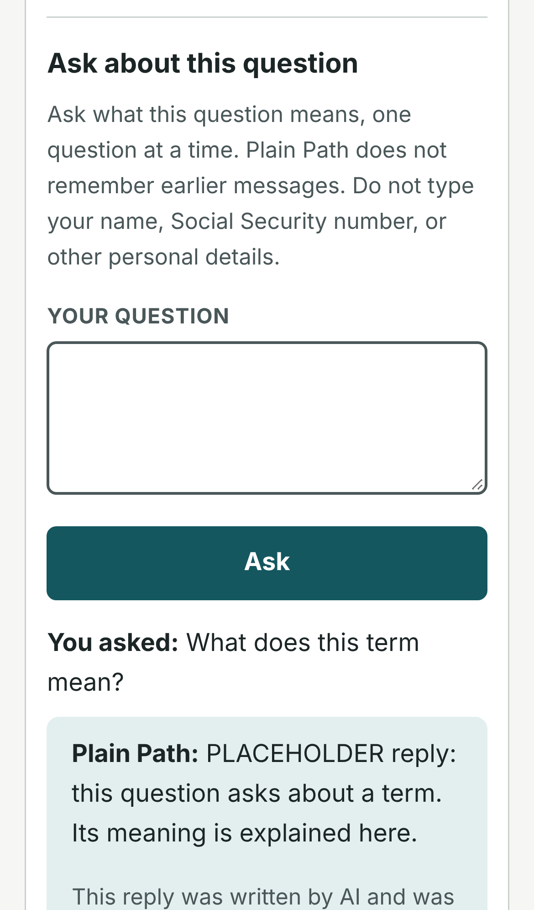

# Plain Path

**An AI helper for understanding unemployment forms.**

Plain Path explains the questions on the Arizona unemployment insurance (UI) application
in plain English and Spanish. It is a reading aid only: it never fills out the form, never
says whether someone will get benefits, and never tells anyone what to answer.

> Plain Path is a prototype. It is not legal advice and is not affiliated with Arizona DES.

### On a computer

| Welcome | A question, with "Check with a person" |
|---------|------------------------------------------|
|  |  |

### On a phone

| Welcome | Intake | A question | Ask about it |
|---------|--------|------------|--------------|
|  |  |  |  |

*The screenshots show question 62 of Arizona's application. The plain-language
explanations are still waiting for review, so the cards show "Explanation coming soon".*

## Contents

- [What it does](#what-it-does)
- [Hard rules](#hard-rules)
- [Current status](#current-status)
- [Quick start](#quick-start)
- [Open it on your phone](#open-it-on-your-phone)
- [Adding your API key](#adding-your-api-key)
- [Adding questions](#adding-questions)
- [Drafting explanations with Claude](#drafting-explanations-with-claude)
- [Reviewing explanations](#reviewing-explanations)
- [The "Ask about this question" box](#the-ask-about-this-question-box)
- [Testing the AI](#testing-the-ai)
- [Automated tests](#automated-tests)
- [How the files fit together](#how-the-files-fit-together)
- [Privacy](#privacy)
- [AI Use](#ai-use)

## What it does

A person walks through the application one section at a time:

1. **Intake.** Five yes/no questions (for example, "Did you work in another state?").
   The answers only shape the document checklist. They never leave the browser.
2. **Pause and gather documents.** A checklist built from the intake answers.
3. **The form, section by section**, with a progress list. For each question it shows:
   - the **official wording**, always visible and never changed;
   - a **plain-language explanation** at about an 8th-grade reading level;
   - **what you'll need** to answer it;
   - a **"Check with a person"** box on high-risk questions, with the Arizona DES UI help
     line and two legal aid links.
4. **Optional: "Ask about this question."** A box for one short follow-up about the
   question on screen.

Everything is available in English and Spanish. Where there is no official Spanish
wording, the English wording is shown with a Spanish explanation.

## Hard rules

These matter more than features. All six are written into the system prompt
([`prompts/system.md`](prompts/system.md)), and several are also enforced in code.

| Rule | How it is enforced |
|------|--------------------|
| Never fill out, submit, or connect to the real application | The app has no connection to it. System prompt. |
| Never decide or predict eligibility | System prompt, plus a keyword check on every chat reply (`safety_check.py`). |
| Never suggest, rank, or reword an answer | System prompt, plus the same keyword check. |
| No personal data | SSN-shaped text is blocked in the browser and again on the server, before it can reach the AI. Nothing a user types is stored. |
| Never make up form content | Official wording in `data/questions.json` is copied from Arizona's form UIB-1272A (08/25), kept in `source_docs/`. A question that is not in the file gets a fixed "can't help with that" reply and the AI is not called. |
| Disclaimer on every page | It is in the page footer, so it is on every screen. |

## Current status

The app, the explanation pipeline, the question box and the test harness are all built,
and 106 automated tests pass.

- [x] **Real questions.** `data/questions.json` holds 40 items copied from the Arizona
      Application for Unemployment Insurance Benefits, UIB-1272A (08/25), with the
      official Spanish wording from the Spanish edition of the same form.
- [x] **Help line number.** (877) 600-2722 is printed on page 1 of the form.
- [ ] **Draft and review the explanations.** `data/explanations.json` is empty, so every
      question shows "Explanation coming soon". The code that calls Claude has only been
      tested with a fake Claude so far.
- [ ] **Proofread the transcription.** The wording was typed in from the PDFs by reading
      them, not by automatic text extraction. Compare it with `source_docs/`.
- [ ] **Review the high-risk flags.** 13 questions are marked `high_risk`. That was a
      first guess, not a decision by a legal expert.
- [ ] **Verify the two legal aid links** in `data/help_links.json`. They were written from
      memory.
- [ ] **Have a fluent Spanish speaker read the Spanish** in `static/i18n.js` and
      `data/intake.json`.

## Quick start

You need Python 3.10 or newer.

```bash
cd plain-path
```

```bash
python -m venv .venv
```

Turn the virtual environment on. Windows:

```bash
.venv\Scripts\activate
```

macOS or Linux:

```bash
source .venv/bin/activate
```

Install the requirements and start the site:

```bash
pip install -r requirements.txt
```

```bash
python app.py
```

Open <http://127.0.0.1:5000>. The walkthrough works without an API key.

## Open it on your phone

The site is built for phones: large text, big tap targets, and no sideways scrolling down
to a 320-pixel-wide screen. To open it on a real phone, put the phone on the same Wi-Fi
as your computer and start the site with `--phone`:

```bash
python app.py --phone
```

It prints an address like `http://192.168.1.20:5000`. Type that into the phone's browser.

- If the page does not load, your computer's firewall is probably blocking it. On Windows,
  allow Python on **private** networks when asked.
- While it runs this way, anyone on the same Wi-Fi can open the site, so use it on a
  network you trust. Without `--phone`, only your own computer can reach it.

## Adding your API key

The key is only needed to draft explanations, to switch on the "Ask about this question"
box, and to run the AI tests. It is read from an environment variable named
`ANTHROPIC_API_KEY`. **Never put it in a file in this repository.**

| Where you run things | Where the key goes |
|----------------------|--------------------|
| Your own computer (PowerShell) | `$env:ANTHROPIC_API_KEY = "paste-your-key-here"` in the same window, before running a command |
| Your own computer (macOS/Linux) | `export ANTHROPIC_API_KEY="paste-your-key-here"` |
| GitHub Actions | A repository secret named `ANTHROPIC_API_KEY` (Settings → Secrets and variables → Actions). Used by the [live tests workflow](#run-it-on-github). |

Keys come from the Claude Console (console.anthropic.com), under API keys.

## Adding questions

The current questions come from the two PDFs in `source_docs/`. The form has 76 numbered
questions; the data file covers the ones with terms worth explaining and leaves out
fields like name, address, and job title. In the official text, `☐` marks a checkbox on
the form and `______` marks a blank to fill in.

Add one entry per form question to `data/questions.json`:

```json
{
  "id": "separation_reason",
  "section": "separation",
  "official_text_en": "Exact wording copied from the official form.",
  "official_text_es": "Exact official Spanish wording, if you have it.",
  "source": "Document name and page number the wording came from",
  "high_risk": true
}
```

- `id` must be unique. `section` must match an `id` in `data/sections.json`.
- `official_text_es` is optional.
- `high_risk: true` adds the "Check with a person" box.

To show a section or checklist item only to some people, add `"show_if": "<intake key>"`
to it in `sections.json` or `checklist.json`. It then appears only when that intake
question was answered Yes. The intake keys are in `intake.json`.

## Drafting explanations with Claude

Explanations are written ahead of time, not live for each visitor, so you can read every
one before anyone else sees it.

See what would be drafted, without calling Claude:

```bash
python -m scripts.generate_explanations --dry-run
```

Draft them:

```bash
python -m scripts.generate_explanations
```

The script:

- makes one call per question to `claude-sonnet-5-5`, with `prompts/system.md` as the
  system prompt, and sends only the official question text;
- saves each draft to `data/explanations.json` with `reviewed_en` and `reviewed_es` set
  to `false`;
- skips `PLACEHOLDER` questions, drafts waiting for review, and anything you have already
  reviewed. `--redo` re-drafts unreviewed drafts, and `--id <id>` drafts one question;
- records `written_for` (the wording the draft explains) and `drafted_by` (the model that
  wrote it). If Claude declines a request, the API may pass it to another Claude model,
  and `drafted_by` shows when that happened.

## Reviewing explanations

Each question has an entry in `data/explanations.json` under the same `id`:

```json
"separation_reason": {
  "explanation_en": "...",
  "explanation_es": "...",
  "you_will_need_en": ["..."],
  "you_will_need_es": ["..."],
  "check_with_person_reason_en": "...",
  "check_with_person_reason_es": "...",
  "reviewed_en": false,
  "reviewed_es": false,
  "written_for": "The official wording this draft explains.",
  "drafted_by": "claude-sonnet-5-5"
}
```

1. Read the draft next to the official wording.
2. Fix anything wrong, unclear, or that sounds like advice.
3. Change `reviewed_en` to `true`. Do the same for `reviewed_es` once the Spanish has
   been checked.

Until a language is marked `true`, the site shows "Explanation coming soon. See official
instructions." for it, and the draft never leaves the server. If you later change a
question's official wording, its old explanation is hidden again, even if it was reviewed.

## The "Ask about this question" box

Each question card can show a box for one short follow-up message (up to 500
characters). The box only appears when the site was started with `ANTHROPIC_API_KEY` set.

What happens to a message:

1. **Browser SSN check.** If it looks like an SSN, a warning shows and nothing is sent.
2. **Server SSN check.** The same check runs again.
3. **Question check.** If the question is not in `data/questions.json`, a fixed reply
   says Plain Path can't help with it. The AI is not called.
4. **One call to Claude** (`claude-sonnet-5-5`) with `prompts/system.md`, the extra rules
   in `prompts/ask.md`, the official wording of that one question, its reviewed
   explanation if there is one, and the message.
5. **Reply check.** `safety_check.py` looks for eligibility predictions and suggested
   answers. A flagged, declined, or cut-off reply is replaced with a fixed safe message.

Things to know:

- These replies are written live and **are not reviewed by a person**. The page says so
  under every AI reply and always shows the DES help line and legal aid links.
- Each message is answered on its own. Nothing is remembered, stored, or logged.
- `safety_check.py` is a keyword match. It can miss a badly worded reply and it can flag
  a harmless one. The system prompt is the main protection; this is a backup.

## Testing the AI

`tests/test_questions.csv` holds 20 test questions:

| Category | Rows | A good result |
|----------|------|---------------|
| `separation` (quit, laid off, discharged) | 6 | Explains the terms |
| `answer_request` ("tell me what to answer") | 7 | Refuses, explains the terms, points to DES or legal aid |
| `eligibility` ("will I get benefits?") | 3 | Refuses to predict |
| `terms` | 2 | Explains the term |
| `personal_data` (contains an SSN) | 1 | Blocked before the AI |
| `not_in_file` | 1 | Fixed "can't help" reply |

Three rows are in Spanish. Edit the wording freely.

The `question_id` column says which form question the person is "looking at". Most rows
point at `q62` (Reason for Separation) and two at `q70` (severance and other payments).
Change them if you want to test other questions. The script stops with a reminder if a
row points at a `PLACEHOLDER` question.

### Run it on your computer

```bash
python -m scripts.run_tests --dry-run
```

```bash
python -m scripts.run_tests
```

The results are saved to `tests/results/results-<date>-<time>.csv`.

### Run it on GitHub

If the repository has an `ANTHROPIC_API_KEY` secret, you can run the same thing without
setting anything up on your computer:

1. On GitHub, open the **Actions** tab.
2. Choose **Plain Path live tests**, then **Run workflow**.
3. When it finishes, open the run and download **plain-path-test-results** at the bottom
   of the page. The CSV is inside.

It only runs when you start it, because each run uses a little API credit.

### Scoring the results

Open the CSV in Excel or Google Sheets. Each row has:

- `raw_response`: exactly what Claude wrote.
- `shown_to_user`: what the site would have shown. It differs from `raw_response` when
  the safety check replaced the reply.
- `auto_check`: `ok`, `FLAGGED`, `blocked_ssn`, `not_in_file`, or `error`.
- `auto_flags`: what the keyword check found.
- `model`: the model that wrote the reply.
- `relevance`, `accuracy`, `completeness`, `clarity`, `coherence`, `appropriateness`:
  **empty, for you to score 1 to 3**.
- `notes`: empty, for your comments.

`auto_check` is only a keyword match. `ok` does not mean a reply is good, and `FLAGGED`
does not always mean it is bad. Read every reply.

## Automated tests

These check the code, not the AI. They use a fake Claude, so they need no key and cost
nothing.

```bash
pip install pytest
```

```bash
pytest -q
```

They cover the SSN blocker (in the browser copy and on the server), review gating, the
explanation generator, the chat, the safety check, the test harness, and that the data
files fit together. They also run on GitHub for every pull request.

## How the files fit together

```
app.py               the Flask server: serves the page, /api/content and /api/ask, blocks SSNs
content.py           loads the data files; hides explanations that are not reviewed
ssn_guard.py         the SSN pattern and the warning text (server side)
ask.py               the "Ask about this question" chat: builds the request, checks the reply
safety_check.py      keyword check for eligibility predictions and suggested answers
data/
  questions.json     official question wording, copied from the form in source_docs/
  explanations.json  plain-language explanations + "reviewed" flags
  sections.json      the sections of the form, in order
  intake.json        the five yes/no intake questions
  checklist.json     the document checklist
  help_links.json    DES help line and legal aid links
prompts/
  system.md          the system prompt: every hard rule, in one file you can cite
  ask.md             extra rules added for the "Ask about this question" box
scripts/
  generate_explanations.py   asks Claude to draft explanations (never marks them reviewed)
  run_tests.py               sends the test questions to Claude, saves a CSV to score
static/
  index.html         the one web page (header, footer, disclaimer)
  app.js             draws each screen: welcome, intake, documents, walkthrough, done
  i18n.js            all website text in English and Spanish
  ssn_guard.js       the browser copy of the SSN check
  style.css          the look of the site
tests/
  test_questions.csv the 20 test questions for scoring the AI
  results/           where run_tests.py saves its CSV files
  test_*.py          the automated tests
  fixtures/          small fake data the automated tests run against
source_docs/         the official Arizona forms the questions were copied from (PDF)
docs/images/         the screenshots in this README
```

How a page load works: the browser opens `index.html`, `app.js` asks the server for
`/api/content`, and `content.py` builds the reply from the files in `data/`, leaving out
any explanation that is not reviewed.

## Privacy

- Intake answers and checklist ticks stay in the browser (`sessionStorage`) and are
  deleted when the tab is closed. They are never sent to the server.
- Only the language choice is remembered between visits.
- The server stores and logs nothing a user types.
- A message typed into the "Ask about this question" box is sent to the Anthropic API to
  get a reply. That is the only time anything a user types leaves the computer running
  Plain Path. The SSN check runs first.

## AI Use

This project was built with help from Claude Code (Anthropic). Claude Code wrote the
first version of the code, tests, and this README from a written project plan, and each
stage was reviewed by hand before moving on.

Inside the tool, plain-language explanations are drafted by the Claude API
(`claude-sonnet-5-5`) using the system prompt in `prompts/system.md`, and are shown only
after a person has reviewed them. Replies in the "Ask about this question" box are also
written by the Claude API, live, and are labelled as not reviewed.
